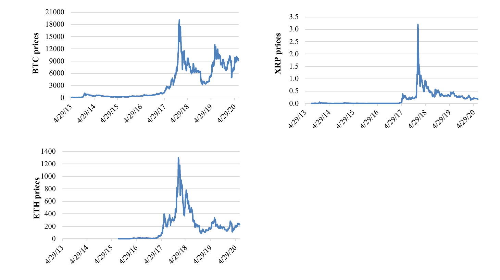
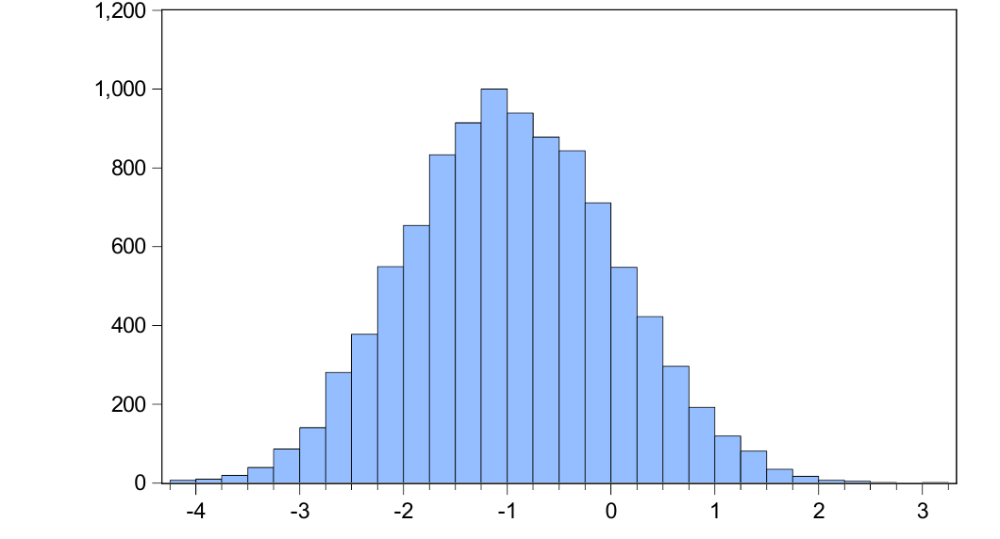

# An empirical test for bubbles in cryptocurrency markets

George A. Waters

Professor

Department of Economics

Illinois State University

Normal, IL 61790-4200

<gawater@ilstu.edu>

and

Thuy Bui

Department of Management Science & Information Systems

Rutgers Business School

Newark, NJ, 07102

<tb680@business.rutgers.edu>

> **Abstract:**
>
> In an asset market without bubbles, meaning the strong efficient markets hypothesis is satisfied, the price and dividend should be cointegrated. However, standard unit root tests have low power against a class of Periodically Collapsing Rational Bubbles introduced by Evans (1991), which are an intuitive model of speculative behavior. The cryptocurrency markets for bitcoin, ethereum, and ripple do not have dividends, so the tests are conducted using five different proxies for fundamentals. In most cases the price and fundamental data are integrated of order one, according to a minimum LM test for unit roots that allows for breaks. Using a robust test for cointegration that controls for the skewness and excess kurtosis that could arise with such bubbles, one cannot reject the presence of Period Collapsing Rational Bubbles in any of the cryptocurrency markets. The distribution of such tests is non-standard, so significance levels are determined with Monte Carlo experiments.
>
> **Keywords:** Cryptocurrency, Bitcoin, Ethereum, Ripple, Bubble, Cointegration, Residuals Augmented Dickey Fuller Test
>
> **JEL codes:** C22, G1

## 1 Introduction

The ups and downs in the price of cryptocurrencies call into question the efficiency of these markets (Makarov and Schoar, 2019). In this paper we investigate the presence of bubbles for three of the largest cryptocurrencies, bitcoin (BTC), ethereum (ETH), and ripple (XRP).

The most common method for empirical detection of bubbles is a test of cointegration between an asset price and an associated fundamental value. However, testing for bubbles complicates the testing procedure. For example, if the null is non-cointegration then the test must be able to reject the presence of an explosive process. This study focuses on the test of Taylor and Peel, which controls for excess skewness and kurtosis that would likely arise. The test is designed to detect bubbles of the form given by the Periodically Collapsing Rational Bubbles model of Evans (1991).

Another issue that arises in the context of cryptocurrencies is identity of the fundamental value. Since there are no values such as dividends, earning or profits, as with stocks, we adopt a variety of proxies. Some studies like Cochrane (2017) focus on the convenience yield of holding bitcoin as a method for transferring wealth, which should be stable. Others such as Hayes (2019) treat the mining cost, which is proportional to the quantity of a cryptocurrency, as fundamental. The present study tests using both the quantity of a currency and a constant as fundamental as well as alternative investment vehicles such as gold and the S&P 500 stock market index.

The presence of PCRB cannot be rejected for any of the three cryptocurrencies. Some tests on ethereum show that the price and quantity are integrated of different orders, which is evidence of non-cointegration. For all three cryptocurrencies, the Dickey-Fuller test and the Taylor and Peel (1998) test on the residual of OLS regression on the price and fundamental, cannot reject non-stationarity at any reasonable level, most *p*-values being above 0.5.

## 2 Theory

A standard asset pricing relation motivates the potential for rational bubbles and the econometric techniques that might be used to detect them. A bubble implies that asset price movements cannot be explained by fundamentals, such as dividends and earnings in the context of stock prices. Naturally, bitcoin does not have a dividend and determining the information that represents fundamentals is a difficult question. We refer to dividends for the purpose of developing the necessary asset pricing theory and defer the discussion of fundamentals for virtual currency to section 4. The price of an asset $`P_{t}`$ depends on expected future price and dividend $`D_{t + 1}`$, where *r* is the interest rate so $`\frac{1}{1 + r}`$ acts as a discount factor.

```math
P_{t} = {\frac{1}{1 + r}E}_{t}\left( P_{t + 1} + D_{t + 1} \right)
```
Solving recursively under rational expectations, one can express the price in terms of expected future dividends.

```math
P_{t} = \sum_{j = 1}^{\infty}{{(\frac{1}{1 + r})}^{j}E_{t}D_{t + j}} + B_{t} \qquad (1a)
```
The term *B<sub>t</sub>* must satisfy the sub-martingale property *B<sub>t</sub> =* $`\frac{1}{1 + r}`$ *E<sub>t</sub>B<sub>t+1 </sub>* which represents a bubble produced by self-fulfilling expectations. Hence, the price of an asset $`P_{t}`$ can be split between its fundamental value $`F_{t}`$ and a bubble term $`B_{t}`$

```math
P_{t} = F_{t} + B_{t} \qquad (1b)
```
where the fundamental price $`F_{t}`$ is given by discounted expected future dividends

```math
F_{t} = \sum_{j = 1}^{\infty}{{(\frac{1}{1 + r})}^{j}E_{t}D_{t + j}}, \qquad (1c)
```
which is the solution for $`P_{t}`$ associated with the strong version of the Efficient Markets Hypothesis. It is often argued that a transversality condition, which guarantees that the asset price does not diverge, ensures that the bubble term *B<sub>t</sub>* must be zero so $`P_{t} = F_{t}`$. However, there are models of rational bubbles such as the Periodically Collapsing Rational Bubble (PCRB) of Evans (1991) that do not diverge inevitably.

To examine possible cointegration between price and dividends, write Equation (1a) as follows.

``` math
P_{t} - {\frac{1}{r}D}_{t} = \left( \frac{1 + r}{r} \right)\sum_{j = 1}^{\infty}{\left( \frac{1}{1 + r} \right)^{j}E_{t}\Delta D_{t + j}} + B_{t}
```

For reasonable specifications, the first difference of dividends $`\Delta D_{t + j}`$ is stationary, so if the bubble term is zero *B<sub>t</sub>*=0, then the price and dividend are cointegrated.

Rejection of cointegration between $`P_{t}`$ and $`D_{t}`$ implies the lack of a common trend and constitutes evidence of a bubble.

Diba and Grossman (1988) argue that the one-sided test of Bhargava is superior to the standard Dickey-Fuller tests for asset markets. However, such tests have little power to reject the PCRB model of Evans (1991). Taylor and Peel (1998) develop a robust test that is able to detect PCRB and is the focus of the present work.

The PCRB model of Evans (1991) has two regimes, the second of which has explosive growth, given by the following.

```math
B_{t + 1} = (1 + r)B_{t}u_{t + 1}\qquad \text{if } B_{t} \leq \alpha \qquad (2)
```
```math
B_{t + 1} = \left\lbrack \delta + \pi^{- 1}(1 + r)\theta_{t + 1}\left( B_{t} - (1 + r)^{- 1}\delta \right) \right\rbrack u_{t + 1}\qquad \text{if } B_{t} > \alpha \qquad (3)
```
Where $`\alpha`$ and $`\delta`$ are positive parameter such that $`0 < \delta < (1 + r)\alpha`$ and $`u_{t + 1}`$ is a stochastic variable with mean one. $`\theta_{t + 1}`$ is an exogenous independent identically distributed random Bernoulli process and takes the value 1 with probability $`\pi`$ and 0 with the probability $`1 - \pi`$.

The behavior of bubbles in the PCRB process depends on the threshold $`\alpha`$. If $`B_{t} \leq \alpha`$, the bubble grows at mean rate 1+ r. When the bubble goes beyond the threshold $`\alpha,`$ it starts growing at the faster mean rate $`\pi^{- 1}(1 + r)`$ until it collapses and falls to $`\delta`$ . The probability of bubble collapse in each period is $`1 - \pi`$. By varying the parameters $`\delta`$, $`\alpha`$, and $`\pi`$, one can determine the frequency with which bubbles explode, the average length of time before collapse, and the scale of the bubble.

The PCRB model satisfies rational expectations and does not violate a transversality condition. The bubble is rational in the sense that there are no excess returns $`{E_{t}B}_{t + 1} = (1 + r)B_{t}.`$ Since bubbles collapse, the price does not diverge in the long run. The model also gives an intuitive description of speculative behavior, since agents try to take advantage of the explosive behavior even with the knowledge of an eventual collapse, see Waters (2019). The PCRB model has too many free parameters to estimate parametrically, but Monte Carlo tests using it as an alternative to a stationary process can help determine the power of tests to reject bubbles. For varying choices of the parameters, the model can simulate any desired degree of volatility, making it an appropriate choice for virtual currency data. Taylor and Peel conduct such tests to demonstrate the power and significance of the test for detecting bubbles.

Standard cointegration tests would have difficulty identifying bubbles since the PCRB could appear to be a persistent autoregressive process. The robust test of Taylor and Peel (1998) addresses this problem by controlling for skewness and excess kurtosis, which is verified by Monte Carlo tests described above.

Evans’ (1991) PCRB model is not the only possible choice. Waters (2019) develops a model where a rational bubble forecast is one of a number of forecasting strategies. There are numerous behavioral asset pricing model where agents use trend following or “chartist” forecasting strategies to name two, see Hommes and Wagener (2009) for an overview.

## 3 Data description

All series are daily and fall within the period from 04/29/2013 to 06/30/2020. The data of bitcoin (BTC), ethereum (ETH), and ripple (XRP) prices are the maximum data collected from coinmarketcap.com. The S&P 500 index (SP 500) and gold prices (GP) are gathered from Yahoo Finance (finance.yahoo.com), and gold.org websites respectively.

**Graph 1: Bitcoin, Ethereum, and Ripple prices**



The prices of bitcoin, ethereum, and ripple start increasing rapidly from 2017 and hit a peak at the end of the year. In 2017, the ethereum and ripple prices increase nearly 80 times and 300 times, respectively. In comparison to other types of investments such as stocks or gold, the volatilities of cryptocurrencies are much higher, see Table 1.

The approximate maximum market values of the currencies can be found by multiplying the maximum price and quantity. Bitcoin has the greatest maximum value by far of \$3.51E12 compared to those of ethereum \$1.42E11 or ripple \$1.46E11.

**Table 1:** Data summary

| **Variables** | **Obs** | **Min** | **Max** | **Mean** | **Std. dev** | **Coeff. of Variation** |
|:---|:--:|:--:|:--:|:--:|:--:|:--:|
| BTCP | 1807 | 68.430 | 19114.200 | 3440.239 | 3899.229 | 1.133 |
| BTPQ | 1807 | 1.11E08 | 1.84E08 | 1.55E08 | 2.08E07 | 0.135 |
| XRPP | 1739 | 0.003 | 3.200 | 0.188 | 0.297 | 1.580 |
| XRPQ | 1739 | 7.82E09 | 4.43E10 | 3.29E10 | 1.14E10 | 0.347 |
| ETHP | 1233 | 0.435 | 1299.740 | 202.469 | 227.789 | 1.125 |
| ETHQ | 1233 | 6.01E07 | 1.12E08 | 9.50E07 | 1.19E07 | 0.125 |
| GP | 1807 | 1049.400 | 1771.600 | 1297.380 | 131.938 | 0.102 |
| SP500 | 1807 | 1573.090 | 3386.150 | 2345.504 | 443.291 | 0.189 |

## 4 Fundamentals

The volatility of the cryptocurrencies is suggestive of bubbles. The coefficients of variation of the virtual currency prices are at least five times that of gold and the S&P500 stock index. Speculative bubbles are not the only potential source of volatility, however. Simple changes in preferences or information are alternative hypotheses, so a formal test for bubbles is required.

With virtual currencies, the cointegration test for bubbles described above raises the immediate question: What are the fundamentals? None of the currencies pays dividends, earnings or rent, like other assets. What purpose they serve remains and open question. Shiller (2017) says any effort to put a fundamental value on bitcoin is flawed. The empirical investigation of Cheah and Fry (2015) gives evidence that the fundamental value of bitcoin is zero.

Cochrane (2017) identifies the convenience yield of holding bitcoin as a medium of exchange, but the volatility of the value makes it minimally useful for purchases. The convenience yield would presumably be small and stable for the currencies so far. A more likely use is a means to transfer wealth across borders when there are capital controls or other barriers. There is evidence that such transfers have occurred, though it is doubtful virtual currencies could take over the market, see Zaharia and Kim (2018), and the demand for such transfers should be stable.

Since the choice of fundamental is not clear, we conduct the tests for a number of different variables, a constant, a constant with a time trend, the quantity of the currency, the gold price and the S&P 500 index, following Waters (2019). The first two represent the stable value of the currency represented by the convenience yield or for use transferring wealth. These are equivalent to direct tests for a unit root in the price. The quantity is proportional to the cost of production, which is suggested as a fundamental value by Hayes (2019). Gold and the S&P500 index are not fundamentals in the usual sense, but they are alternative investment vehicles that should have a long run relationship with competing stores of value like the virtual currencies.

## 5 Preliminary Tests

The presence of periodically collapsing bubbles cannot be rejected at any reasonable level of significance for bitcoin, ethereum, or ripple. Tests for cointegration are conducted for five different proxies for fundamentals. The primary evidence is the computed CR statistic from the test of Taylor Peel (1998), but it is complemented by standard unit root tests as well.

Cointegration requires series to be integrated of the same order. Tables 2 shows results for Augmented Dickey Fuller tests (ADF) on the logs and log differences $`(\mathrm{\Delta})`$ for bitcoin price (BTCP), bitcoin outstanding quantity (BTCQ), ethereum price (ETHP), ethereum outstanding quantity (ETHQ), ripple price (XRPP) and ripple outstanding quantity (XRPQ). The number of lags is chosen by the Schwarz information criterion. For variables that are potentially growing exponentially, the most appropriate tests are on the log transformed variables, as detailed in Waters (2008). For completeness, we report the results for the levels in the Appendix.

**Table 2: Augmented Dickey- Fuller Test**

The null hypothesis is non-stationarity. The number of lags is determined by the Schwarz Information Criterion.

| **Variable** | **ADF** | **p-value** | **lags** | **Variable** | **ADF** | **p-value** | **lags** |
|:--:|:--:|:--:|:--:|:--:|:--:|:--:|:--:|
| log(BTCP) | -0.9276 | 0.7799 | 0 | log(BTCQ) | -6.6295 | 0.0000\*\*\* | 11 |
| $`\mathrm{\Delta}`$log(BTCP) | -43.8565 | 0.0001\*\*\* | 0 | $`\mathrm{\Delta}`$log(BTCQ) | -1.3905 | 0.5884 | 19 |
| log(ETHP) | -1.4891 | 0.5391 | 0 | log(ETHQ) | -8.1934 | 0.0000\*\*\* | 17 |
| $`\mathrm{\Delta}`$log(ETHP) | -39.6763 | 0.0000\*\*\* | 0 | $`\mathrm{\Delta}`$log(ETHQ) | -4.5641 | 0.0002\*\*\* | 15 |
| log(XRPP) | -1.10606 | 0.7155 | 1 | log(XRPQ) | -2.13227 | 0.2320 | 0 |
| $`\mathrm{\Delta}`$log(XRPP) | -36.22498 | 0.0000\*\*\* | 0 | $`\mathrm{\Delta}`$log(XRPQ) | -40.67592 | 0.0000\*\*\* | 0 |

The results in Table 2 show that all of the cryptocurrency prices are integrated of order one *I*(1) in logs, so for a constant fundamental, this constitutes evidence of non-cointegration, meaning the presence of a bubble cannot be rejected. Of course, as stated, such tests are not ideal, but standard unit root test would tend to reject bubbles too often, and the fact that the tests reported in table 2 cannot is of interest.

Considering the quantities of the currencies as fundamentals is more difficult. The log quantity for ripple log(XRPQ) is *I*(1), so a cointegration test on the price and quantity would be appropriate. For ethereum, the log quantity log(ETHP) appears to be stationary. That the price and quantity of ethereum are integrated of different orders is evidence of non-cointegration. This is also true for bitcoin, though the test on the difference $`\mathrm{\Delta}`$log(BTCQ) cannot reject a unit root, which is unusual.

The graphs of the price are suggestive of a potential source of bias in the ADF tests. Since most appear to be close to constant initially, and highly volatile after a certain data, a unit root test the controls for shifts in regime is appropriate.

Table 3 shows two versions of the “Minimum LM” unit root tests of Lee and Strazizich (2003) that include a time trend and allow for a single break. Lee and Strazizich (2008) says that such tests do not exhibit size distortion common in other endogenous break unit root tests, meaning the test is invariant to the size of the break under both the null that there is no unit root and the alternative. The variable τ<sub>A</sub> is a test statistic for a model that allows for a break in the intercept, while the statistic τ**<sub>C</sub>** is for a model that allows for a break in the trend coefficient as well.

There is clear evidence that the variables are *I*(1) with a couple exceptions. The ripple quantity log(XRPQ) appears to be stationary under the break model reported in the three columns on the right of Table 3 but not under the crash model, so the evidence is mixed. More serious is the case of the ethereum price variable log(ETHP), which appears to be *I*(1) under the break model, but integrated of a higher order under the crash model. Furthermore, the number of lags had to be restricted under the break model for the estimation to converge, so that result should be handled with care. As with the ADF tests in Table 2, the orders of integration for the price and quantity of ethereum do not coincide, which is evidence of the presence of a bubble.

**Table 3: Minimum LM Unit Root Test with a Break**

This table reports the unit root test of Lee and Strazizich (2008) where the null is non-stationarity, while allowing for a break. The test statistic **τ<sub>A</sub>** is associated with a model that allows for a break in the intercept, while the statistic **τ<sub>C</sub>** is associated with a model that allows for a break in the intercept and the trend.

| **Variable** | **τ<sub>A</sub>** | **Break date** | **lags** |  | **τ<sub>C</sub>** | **Break date** | **lags** |
|:--:|:--:|:--:|:--:|:--:|:--:|:--:|:--:|
| log(BTCP) | -2.323 | 7/19/2017 | 28 |  | -2.620 | 3/24/2017 | 28 |
| $`\mathrm{\Delta}`$log(BTCP) | 5.995\*\*\* | 11/21/2017 | 27 |  | -8.292\*\*\* | 3/23/2015 | 27 |
| log(BTCQ) | -0.540 | 2/13/2014 | 28 |  | -2.872 | 9/25/2015 | 27 |
| $`\mathrm{\Delta}`$log(BTCQ) | -3.112\* | 8/12/2016 | 26 |  | -16.424\*\*\* | 7/12/2016 | 7<sup>\#</sup> |
| log(ETHP) | -1.938 | 2/17/2015 | 28 |  | -2.675 | 10/22/2015 | 12 |
| $`\mathrm{\Delta}`$log(ETHP) | -1.443 | 11/1/2013 | 27 |  | -7.121\*\*\* | 10/31/2013 | 2<sup>\#</sup> |
| log(ETHQ) | -1.627 | 12/3/2013 | 25 |  | -3.170 | 12/12/2013 | 25 |
| $`\mathrm{\Delta}`$log(ETHQ) | -3.489\*\* | 10/25/2013 | 27 |  | -13.359\*\*\* | 12/3/2013 | 27 |
| log(XRPP) | -2.090 | 1/27/2017 | 19 |  | -3.078 | 1/11/2017 | 19 |
| $`\mathrm{\Delta}`$log(XRPP) | -4.101\*\*\* | 1/3/2014 | 29 |  | -9.586\*\*\* | 9/25/2014 | 18 |
| log(XRPQ) | -2.646 | 6/3/2014 | 24 |  | -4.601\*\*\* | 6/24/2014 | 24 |
| $`\mathrm{\Delta}`$log(XRPQ) | -8.367\*\*\* | 9/15/2014 | 23 |  | -8.625\*\*\* | 9/15/2014 | 23 |

Tables 4a and 4b show results for a similar analysis of the gold price and the S&P 500 index. The ADF tests in Table 4a show that both series are *I*(1), a result verified for gold by the min LM test in Table 4b. However, that test shows the S&P500 index to be stationary, though that is counterintuitive for a stock price index, and does not hold up for longer sample.

**Table 4a:** These results are for Augmented Dickey- Fuller Test on the null of non- stationarity for Gold price and S&P 500 index

|         **Variable**          | **ADF** | **p-value**  | **lags** |
|:-----------------------------:|:-------:|:------------:|:--------:|
|            log(GP)            | -0.947  |    0.7736    |    0     |
|  $`\mathrm{\Delta}`$log(GP)   | -43.798 | 0.0001\*\*\* |    0     |
|          log(SP500)           | -1.359  |    0.6035    |    9     |
| $`\mathrm{\Delta}`$log(SP500) | -13.255 | 0.0000\*\*\* |    8     |

**Table 4b:** These results are for the Lee and Strazizich (2008) min LM test of the null of non-stationarity with and endogenous break in the intercept **t<sub>A</sub>** or the intercept and trend **t<sub>C</sub>**.

| **Variable** | **τ<sub>A</sub>** | **Break date** | **lags** |  | **τ<sub>C</sub>** | **Break date** | **lags** |
|:--:|:--:|:--:|:--:|:--:|:--:|:--:|:--:|
| log(GP) | -2.030 | 12/31/2014 | 27 |  | -3.052 | 6/25/2019 | 27 |
| $`\mathrm{\Delta}`$log(GP) | -6.907\*\*\* | 1/24/2014 | 27 |  | -9.592\*\*\* | 6/4/2014 | 26 |
| log(SP500) | -3.924\*\*\* | 8/31/2015 | 26 |  | -4.143\*\* | 9/17/2015 | 26 |
| $`\mathrm{\Delta}`$log(SP500) | -4.668\*\*\* | 1/16/2014 | 26 |  | -10.952\*\*\* | 2/28/2014 | 25 |

## 6 Taylor and Peel test for cointegration

With the caveats about ethereum and the S&P 500 index, cointegration tests using the range is fundamentals described is informative about bubbles. The evidence of breaks in the cryptocurrency prices gives another reason to consider the presence of PCRB, which constitute just such a regime shift. The Taylor and Peel (1998) test is designed to detect such a process.

The test for cointegration is done by regressing the cryptocurrency price on the fundamental value and a constant then testing the stationarity of the residuals $`u_{t}`$.

```math
P_{t} = c + {\lambda F}_{t} + u_{t}
```
The Taylor and Peel (1998) test for stationarity takes the form

```math
{\mathrm{\Delta}\hat{u}}_{t} = \beta{\hat{u}}_{t - 1} + \gamma_{1}w_{1t} + \gamma_{2}w_{2t} \qquad (4)
```
where $`{\hat{u}}_{t}`$ is the residual of the initial linear regression of the price on the fundamental value, $`w_{1t}`$ is the transformations of the skewness of $`u_{t}`$ and $`w_{2t}`$ is the transformations of the kurtosis of $`u_{t}`$. Without the $`w`$’s, the test is the standard Dickey-Fuller test for stationarity with no lags (i.e. not augmented). Taylor and Peel (1998) show that the test of the null of non-cointegration $`\hat{\beta}`$ \> 0 including the $`w`$’s performs well in the presence of periodically collapsing bubbles and is capable of detecting explosive departures from the fundamental.

Tables 5, 6, and 7 report results for two tests of the stationarity of the residuals $`{\hat{u}}_{t}`$, the Dickey-Fuller test (DF) and the Taylor-Peel test (CR) for the five specifications of the fundamental value. For the CR test, the null hypothesis is

$`\hat{\beta}`$ \>0, and the estimate is generated by an OLS regression on equation (4). However, the estimated variance of the parameter is non-standard. Taylor and Peel describe how to estimate the variance-covariance matrix for (4). Furthermore, the distribution of CR is non-standard, so Monte Carlo simulations are required.

**Table 5:** Results for Dickey-Fuller (DF) and Taylor and Peel (CR) tests on the null hypothesis of non-stationarity of the residuals in equation (4) for the cointegration test of Bitcoin. The variables *c* and *t* represent a constant and a time trend.

| **Price** | **Fundamental** | **DF stats** | **CR stats** |
|:--|:--:|:--:|:--:|
| log(BTCP) | *c* | -0.9282 | -0.4395 |
| *p*-value |  | (0.470) | (0.656) |
| log(BTCP) | *c, t* | -1.5909 | -1.8664 |
| *p*-value |  | (0.801) | (0.678) |
| log(BTCP) | log(BTCQ) | -1.4862 | -1.4621 |
| *p*-value |  | (0.838) | (0.845) |
| log(BTCP) | log(GP) | -1.2353 | -0.8565 |
| *p*-value |  | (0.695) | (0.797) |
| log(BTCP) | log(SP500) | -0.9995 | -0.5829 |
| *p*-value |  | (0.839) | (0.908) |

Table 5 shows results of the tests on the non-stationarity of the residuals $`u_{t}`$ of the form of equation (4). The DF test is the Dickey-Fuller test with no lags (not “Augmented”), unlike those in Tables 2-4. The CR test is the estimated value from equation (4) with the associated test statistic using the method in Taylor and Peel (1998).

The *p*-values are generated via Monte Carlo experiments on simulated data, again following Taylor and Peel (1998). For example, for the first case in Table 5 using log(BTCP) with a constant fundamental, price data is simulated using a unit root with drift process

```math
P_{t} = k + P_{t - 1} + \varepsilon_{t} \qquad (5)
```
The initial value $`P_{0}`$ is given by the starting value of the log(BTCP) series, and the constant *k* and standard deviation of the shocks $`\varepsilon_{t}`$ are given by the mean and standard deviation of the difference of the series $`\mathrm{\Delta}`$log(BTCP). Series of length 1807, matching the data, are simulated 10,000 times using equation (5), then regressed on a constant each time in the first line of Table 5, then the DF and CR tests statistics are generated from the residuals. The *p*-values are determined by the simulated distribution, which is shown in the Appendix. For the tests using the quantity of the cryptocurrency, gold or the S&P500 index as the fundamental, “dividends” are simulated in a similar fashion.

For the case of log(BTCP), the simulated CR statistics are distributed around a mean of -0.95 with a minimum value of -4.2 and a maximum of 3.2. Though the Jarque-Berra statistic rejects normality, the distribution has a smooth bell shape; see the Appendix. To reject non-stationarity at the 5% significance level would require a CR statistic less than -3.3.

The estimated value for log(BTCP) in Table 5 is -0.4395, which is associated with a *p*-value of 0.6565 according to the simulated distribution, so non-stationarity cannot be rejected for any reasonable level of significance. Similarly, the DF test has a *p*-value of 0.47, which is also evidence of the presence of a bubble even though the DF test has less power to reject PCRB processes. The *p*-value of 0.47 is the smallest in Table 5 for all the choices of fundamentals and tests, so the existence of bubbles cannot be rejected. The results for the other choices of fundamental are even less able to reject non-stationarity, confirming the results of Waters (2019) with a larger sample.

**Table 6:** Results for Dickey-Fuller (DF) and Taylor and Peel (CR) tests on the null hypothesis of non-stationarity of the residuals in equation (4) for the cointegration test of ethereum. The variables *c* and *t* represent a constant and a time trend.

| **Price** | **Independent variables** | **DF stats** | **CR stats** |
|:--|:--:|:--:|:--:|
| log(ETHP) | *c* | -1.4891 | -1.3067 |
| *p*-value |  | (0.3750) | (0.4530) |
| log(ETHP) | *c, t* | -0.9701 | -1.1891 |
| *p*-value |  | (0.9480) | (0.6630) |
| log(ETHP) | log(ETHQ) | -2.6218 | -0.9092 |
| *p*-value |  | (0.041) | (0.242) |
| log(ETHP) | log(GP) | -1.5025 | -1.3264 |
| *p*-value |  | (0.6690) | (0.7380) |
| log(ETHP) | log(SP500) | -1.5265 | -1.2700 |
| *p*-value |  | (0.7130) | (0.8010) |

**Table 7:** Results for Dickey-Fuller (DF) and Taylor and Peel (CR) tests on the null hypothesis of non-stationarity of the residuals in equation (4) for the cointegration test of ripple. The variables *c* and *t* represent a constant and a time trend.

| **Price** | **Independent variables** | **DF stats** | **CR stats** |
|:--|:--:|:--:|:--:|
| log(XRPP) | *c* | -1.0779 | -1.2348 |
| *p*-value |  | (0.6420) | (0.5760) |
| log(XRPP) | *c, t* | -1.3540 | -2.3080 |
| *p*-value |  | (0.8720) | (0.4230) |
| log(XRPP) | log(XRPQ) | -1.1980 | -1.8619 |
| *p*-value |  | (0.893) | (0.582) |
| log(XRPP) | log(GP) | -1.0449 | -1.1631 |
| *p*-value |  | (0.8690) | (0.6850) |
| log(XRPP) | log(SP500) | -1.0846 | -1.1674 |
| *p*-value |  | (0.8820) | (0.8640) |

Table 6 and 7 report the same results for ethereum and ripple. For ripple, the evidence for bubbles is apparent as the minimum *p*-value for the CR test is 0.42. The results for ethereum are similar with the exception of the quantity log(ETHQ) as the fundamental, where the DF statistic is significant at the 5% level. However, the *p*-value for the more reliable CR test is far less significant at 0.242. The result is for a truncated sample, since the quantity jumps dramatically in 8/26/2014, though the results for the full sample are similar. Again, non-stationarity cannot be rejected with any reasonable degree of confidence in any case.

## 7 Conclusion

For the data from 04/29/2013 to 06/30/2020, we cannot reject the presence of rational bubbles in the bitcoin, ethereum, and ripple markets. For minimum LM unit roots tests that allow for endogenous structural breaks, all the relevant series are integrated of order one for at least one specification. The cointegration test of Taylor and Peel (1998) controls for excess skewness and kurtosis in the residuals of a regression of a fundamental value on an asset price. Such a test is designed to detect Periodically Collapsing Rational bubbles (Evans 1991) that standard cointegration tests could miss but cannot reject bubbles in cryptocurrency prices.

For investors the message is clear: caveat emptor. It is quite possible that cryptocurrency prices are driven by speculation, so gains and losses are largely due to luck. Policymakers that might be inclined to influence cryptocurrency markets are advised to show restraint. Markets driven by speculation can be highly sensitive to policy interventions or completely immune to them, so the impact of policy is unknowable. The best a policymaker might hope to accomplish is to inform the public of the dangers.

## Appendix

**Table 8:** Augmented Dickey Fuller Tests on levels and differences of the cryptocurrencies

| **Variable** | **ADF** | **p-value** | **lags** | **Variable** | **ADF** | **p-value** | **lags** |
|:--:|:--:|:--:|:--:|:--:|:--:|:--:|:--:|
| BTCP | -1.8330 | 0.3647 | 12 | ETHP | -2.7718 | 0.0627\* | 14 |
| $`\mathrm{\Delta}`$BTCP | -10.6028 | 0.0000\*\*\* | 11 | $`\mathrm{\Delta}`$ETHP | -6.7328 | 0.0000\*\*\* | 14 |
| BTCQ | -5.7240 | 0.0000\*\*\* | 11 | ETHQ | -6.9193 | 0.0000\*\*\* | 17 |
| $`\mathrm{\Delta}`$BTCQ | -1.4030 | 0.5823 | 19 | $`\mathrm{\Delta}`$ETHQ | -5.0682 | 0.0000\*\*\* | 15 |
| XRPP | -2.92747 | 0.04250\*\* | 21 | XRPQ | -1.91233 | 0.32680 | 0 |
| $`\mathrm{\Delta}`$XRPP | -11.53466 | 0.00000\*\*\* | 20 | $`\mathrm{\Delta}`$XRPQ | -40.76491 | 0.00000\*\*\* | 0 |

**Table 9:** Augemented Dickey-Fuller tests on the level and difference of the gold price (GP) and the S&P 500 Index (SP500).

| **Variable**             |   **ADF** |  **p-value** | **lags** |
|--------------------------|----------:|-------------:|---------:|
| GP                       | -0.574005 |       0.8738 |        0 |
| $`\mathrm{\Delta}`$GP    | -43.85107 | 0.0001\*\*\* |        0 |
| SP500                    | -1.261365 |       0.6494 |        9 |
| $`\mathrm{\Delta}`$SP500 | -12.70555 | 0.0000\*\*\* |        8 |

**Table 10:** Distribution of the 10,000 simulated CR statistics the Monte Carlo experiment using equation (6) for values determined by the log(BTCP).



## References

Bhargava, Alok. “On the Theory of Testing for Unit Roots in Observed Time Series.” *Review of Economics and Finance* 53, 369-384.

Cochrane, John. “The bitcoin market isn’t irrational.” Chicago Booth Review, February 7, 2018

<http://review.chicagobooth.edu/finance/2018/article/bitcoin-market-isn-t-irrational>, accessed March 16, 2021.

Cheah, Eng-Tuck, and John Fry. "Speculative bubbles in Bitcoin markets? An empirical investigation into the fundamental value of Bitcoin." *Economics Letters* 130 (2015): 32-36.

Diba, Behzad T., and Herschel I. Grossman. "Explosive rational bubbles in stock prices?." *The American Economic Review* 78, no. 3 (1988): 520-530.

Evans, George W. "Pitfalls in testing for explosive bubbles in asset prices." *The American Economic Review* 81, no. 4 (1991): 922-930.

Hayes, Adam S. "Bitcoin price and its marginal cost of production: support for a fundamental value." *Applied Economics Letters* 26, no. 7 (2019): 554-560.

Hommes, Cars and Florian Wagener. “Complex Evolutionary Systems in Behavioral Finance.” Chapter 4 in <u>Handbook of Financial Markets: Dynamics and Evolution</u> edited by Thorsten Hens and Klaus Reiner Schenk-Hoppé, Elsevier (2009).

Makarov, Igor, and Antoinette Schoar. "Trading and arbitrage in cryptocurrency markets." *Journal of Financial Economics* 135, no. 2 (2020): 293-319.

Shiller, Robert J. "what is bitcoin really worth? don’t even ask." *New York Times* (2017).

<https://www.nytimes.com/2017/12/15/business/bitcoin-investing.html>

Taylor, Mark P., and David A. Peel. "Periodically collapsing stock price bubbles: a robust test." *Economics Letters* 61, no. 2 (1998): 221-228.

Waters, George A. "Unit root testing for bubbles: A Resurrection?" *Economics Letters* 101, no. 3 (2008): 279-281.

Waters, George A. "Bubbles and rationality in bitcoin." *Economic Notes: Review of Banking, Finance and Monetary Economics* 48, no. 2 (2019): e12133.

Zaharia, Marius and Dahee Kim. “Bitcoin start-ups in Asia take aim at remittances market.” Reuters online, March 13, 2018, <https://www.reuters.com/article/us-crypto-currencies-remittances/bitcoin-start-ups-in-asia-take-aim-at-remittances-market-idUSKCN1GP117>, accessed March 16, 2021.
